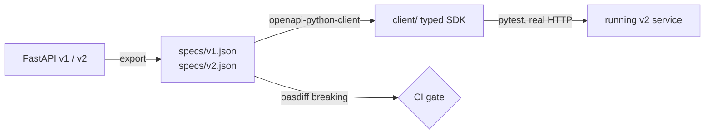

# openapi-sdk-demo

A sample **FastAPI** service whose **OpenAPI spec is committed to the repo**, a **typed Python client generated from that
spec**, and a **CI gate that fails on breaking schema changes** between API versions.

> **Honest scope:** this is a learning and portfolio project. It runs on synthetic data, has no real users, and makes no
> production claims. It shows the spec → SDK → compatibility-check workflow end to end, at a deliberately small size.

## Contents

- [What it does](#what-it-does)
- [How it works](#how-it-works)
- [What this project demonstrates](#what-this-project-demonstrates)
- [Quick start](#quick-start)
- [Schema evolution: v1 to v2](#schema-evolution-v1-to-v2)
- [Project layout](#project-layout)
- [Known limits](#known-limits)

## What it does

A tiny claims API (`GET /claims`, `GET /claims/{id}`, `POST /claims`) over three invented claims. The point is not the API;
it is everything around it: the spec is the contract, the client is derived from it, and CI protects it.

## How it works



## What this project demonstrates

- **Spec as a committed artifact.** CI re-exports the specs from code and fails if the committed copies are stale.
- **Generated, typed client.** `openapi-python-client` produces models and per-operation functions from `specs/v2.json`.
  CI regenerates it and fails on drift, so the client can't silently diverge from the spec.
- **Client tested against the live service.** `tests/test_client.py` starts uvicorn and calls it through the generated
  client over real HTTP (no mocks), including the fields and parameters added in v2.
- **Breaking-change detection.** [`oasdiff`](https://github.com/oasdiff/oasdiff) compares v1 and v2 and exits non-zero on
  breaking changes.
- **Acknowledged breaks are explicit.** Intentional breaks are listed in `specs/breaking-ack.txt`; anything breaking that
  is *not* listed fails CI. Tests prove the gate fails without the acknowledgement and when only some changes are listed.

## Quick start

Needs [uv](https://docs.astral.sh/uv/) and [oasdiff](https://github.com/oasdiff/oasdiff) (`brew install oasdiff`).

```bash
uv sync
make test      # specs in sync, gate behaviour, generated client vs running service
make serve     # v2 at http://127.0.0.1:8000/docs
make compat    # breaking-change gate
make specs     # re-export specs after changing the API code
make client    # regenerate the SDK after changing specs/v2.json
```

Using the client:

```python
from client import Client
from client.api.default import list_claims
from client.models import Status

c = Client(base_url="http://127.0.0.1:8000")
for claim in list_claims.sync(client=c, status=Status.DENIED, limit=10):
    print(claim.id, claim.amount_cents, claim.denial_code)
```

## Schema evolution: v1 to v2

| Change | Kind | oasdiff verdict |
|---|---|---|
| `limit` optional query param on `GET /claims` | backward-compatible | info |
| `provider_name`, `denial_code` optional response fields | backward-compatible | info |
| `amount` (float dollars) replaced by `amount_cents` (int) | **breaking (deliberate)** | error ×4, warning ×1 |

The break is real: a v1 client reading `amount` from a response, or sending it on `POST /claims`, stops working.
Run `oasdiff breaking specs/v1.json specs/v2.json` to see the raw findings. In a real service you would avoid this by
adding `amount_cents` alongside `amount`, deprecating the old field, and removing it in a later major version.

## Project layout

```
claims_api/        v1.py (frozen baseline), v2.py (current), data.py (synthetic claims)
specs/             v1.json, v2.json (exported, committed), breaking-ack.txt
client/            generated SDK (do not edit by hand; run `make client`)
scripts/           export_specs.py, generate_client.sh, check_compat.sh
tests/             test_client.py (client vs live service), test_spec.py (spec sync + gate)
.github/workflows/ ci.yml
```

## Known limits

- Synthetic data, in-memory storage, no auth, no pagination, no persistence. Not a production API design.
- v1 and v2 are two small modules in one repo for demo purposes; a real service would version via releases/tags and
  diff the PR's spec against the spec on `main` or the last released tag.
- Only the Python client is generated and tested; the same spec would feed `openapi-generator` for other languages.
- The acknowledgement file matches oasdiff's message text, so it is tied to this oasdiff version (pinned in CI).
